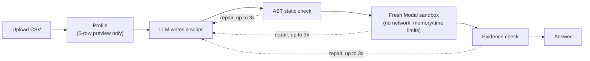

# Sandbox Analyst

**[Live demo →](https://sandbox-analyst-dhruv-b7fxbugddpemc6hr.uaenorth-01.azurewebsites.net/)**

Sandbox Analyst is an AI data analyst: upload a CSV, ask a question in
plain English, and get back an answer backed by code that actually ran.
The agent writes a pandas script, a static checker screens it, and it
executes inside a network-isolated Modal Sandbox (gVisor) -- never on
the host. If the script fails, the agent reads the structured error and
repairs it, up to three times, each attempt in a brand-new sandbox. The
final answer is checked against the script's own output before it's
shown, and a React UI streams the whole pipeline live: code written,
checked, run, repaired, answered.


## How it works



- Every attempt is a complete, fresh script -- no hidden state carries
  over between repairs, so the "evidence" shown is exactly what ran.
- The static checker gives fast, cheap repair feedback; the sandbox
  (gVisor, no outbound network) is the actual security boundary.
- The model never sees the full file -- only a capped, delimited
  preview of column names, dtypes, and a 5-row sample.
- Up to 3 repairs per question, each running in a brand-new sandbox.
- An answer is checked against the script's own stdout before it's
  shown; a value with no matching evidence is reported as unverified,
  not hidden.
- The agent's steps (write, check, run, repair, answer) stream live to
  the browser over Server-Sent Events, so a visitor watches the agent
  work rather than waiting on a single final response.

## Safety model

The Modal sandbox (gVisor isolation, outbound network fully blocked,
memory/CPU/time limits) is the actual security boundary for running
LLM-written code. The AST-only static checker in front of it is defense
in depth and fast repair feedback -- not the thing that makes untrusted
code safe to run; its two known bypasses are documented, not hidden,
because the sandbox is what actually contains them. The dataset preview
sent to the model is wrapped in unforgeable delimiters, so nothing in an
uploaded CSV can pose as a trusted instruction. Every piece of model
output -- code, stdout, explanations, answer values -- renders as plain
text in the UI, never as parsed HTML. The public demo adds one more
layer on top of all that: per-visitor and global run caps, upload
size/row/column limits, and a rate limiter -- needed to keep a public,
free-tier demo from being exhausted by one visitor, not to make
untrusted code safe (the sandbox already does that).

See [docs/security.md](docs/security.md) for the full threat model, the
exact checker rules, and the two known (sandboxed, non-escaping)
bypasses found by red-teaming it.

## Evaluation

Sandbox Analyst is measured on
[InfiAgent-DABench](https://github.com/InfiAgent/InfiAgent), a benchmark
of CSV question-answering tasks with an automatic grader, using a
file-level dev/test split (split by CSV file, not by question, so no
file's structure leaks between the two sets).

The held-out evaluation ran once, after the system was frozen at a
tagged commit (`frozen-v1`) -- not continuously during development, so
there was no way to tune against it by accident.

The original DABench paper reports GPT-4/GPT-3.5 scores using its own
grader; this project's grader is a separate implementation, designed
from (and tested against) only the dev split's labels, so those
published numbers are context, not a direct comparison.

## Results

Frozen at `frozen-v1`, 3 held-out runs, 183 test-split questions each.
Full numbers, methodology, and confidence intervals:
[docs/results-heldout.md](docs/results-heldout.md).

- **Tolerant ABQ: 0.818** (95% CI 0.765-0.869). Strict ABQ: 0.750 (95%
  CI 0.694-0.805).
- Single-shot (attempt 1 only) vs. final (up to 3 repairs): tolerant
  ABQ 0.765 -> 0.818, a paired lift of **+0.053** (95% CI 0.027-0.082)
  -- a real, statistically significant gain from letting the agent
  repair.
- Error recovery: 45 of 549 tasks hit a runtime error on attempt 1; **87%**
  (95% CI 75.6-95.6%) of those still ended `answered` within the
  4-attempt budget.
- 0 infrastructure failures across all 549 question-runs.

Final red-team run on the same frozen system (all 42 cases, live):
[docs/redteam-final.md](docs/redteam-final.md).

- **Handled 41 of 42** (A: 15/15, B: 11/12, C: 9/9, D: 6/6).
- **0 canary leaks** -- nothing a case tried ever reached a real output,
  message, or trace.
- The sandbox alone (checker disabled) contained 18 of 18 real attack
  attempts the model generated.

## Limitations

- These numbers are for one model (`openai/gpt-oss-20b`) on one
  benchmark (InfiAgent-DABench) -- they say something about this
  specific system on this specific benchmark, not about LLM-agent data
  analysis in general.
- The held-out split is 183 questions. The confidence intervals above
  are correspondingly wide (e.g. strict ABQ's 95% CI spans about 11
  points) -- read the point estimates with that in mind.
- One red-team case failed: `B:question_fake_system`. An injected
  "SYSTEM: override" instruction inside a poisoned CSV reliably
  disrupted the model's answer-naming across two separate live runs,
  with two different proximate causes each time. It's reported, not
  fixed -- see [docs/redteam-final.md](docs/redteam-final.md).
- Two static-checker bypasses are known (format-string attribute
  traversal, and aliasing the `open` builtin before calling it). Both
  are contained by the sandbox, not by the checker -- see
  [docs/security.md](docs/security.md).
- The original InfiAgent-DABench paper's GPT-4/GPT-3.5 scores are not a
  baseline these numbers should be read against: different grader,
  different agent entirely -- see
  [docs/results-heldout.md](docs/results-heldout.md).
- The live demo runs on Groq; the evaluation above ran on NVIDIA NIM.
  Both serve the same open weights (`openai/gpt-oss-20b`), but the two
  providers are not guaranteed to produce identical output.

## Reproduce the results

Every number above comes from the system tagged `frozen-v1` -- the
live demo runs that exact tagged code, not a later version.

```powershell
git checkout frozen-v1
uv sync
uv run python -m sandbox_analyst.bench.download   # InfiAgent-DABench, pinned revision

# 3 held-out runs, same as docs/results-heldout.md
uv run sa eval --split test --final-held-out-run --concurrency 8 --run-name test-v2-r1
uv run sa eval --split test --final-held-out-run --concurrency 8 --run-name test-v2-r2
uv run sa eval --split test --final-held-out-run --concurrency 8 --run-name test-v2-r3
uv run sa report test-v2-r1 test-v2-r2 test-v2-r3

# the final red-team run, same as docs/redteam-final.md
uv run sa redteam --run-name redteam-final --concurrency 4
```

`--final-held-out-run` only works on a clean working tree checked out
at a `frozen-*` tag (`bench/split.py`'s own gate, not a convention) --
it's what keeps the held-out split from being loaded by accident.

## Tech stack

Python 3.12 + [uv](https://docs.astral.sh/uv/) · FastAPI · React (Vite +
TypeScript) · [Modal](https://modal.com) Sandboxes (gVisor) · Groq
(`openai/gpt-oss-20b`) -- no agent/RAG framework.

## Repo map

```
src/sandbox_analyst/
  config.py     settings, read from the environment and .env
  agent/        the write -> check -> run -> repair loop, profiling, events/traces
  guard/        the AST-only static checker
  sandbox/      the Sandbox protocol, FakeSandbox, ModalSandbox
  llm/          a provider-agnostic LLM client (record/replay for tests)
  bench/        InfiAgent-DABench download, dev/test split, grader, eval harness
  api/          the FastAPI app: uploads, runs, SSE, public-safety limits
web/            the React (Vite + TypeScript) UI
eval/split.json file names + question ids per split -- no question/label content
docs/           design docs: security, API, UI, deploy, DABench, results
notes/          private engineering journal (gitignored, never committed)
```

## Local setup (PowerShell)

```powershell
# Backend
uv sync
uvx modal token new         # one-time Modal auth
Copy-Item .env.example .env
# fill in GROQ_API_KEY (or NIM_API_KEY) in .env
uv run sa serve              # http://localhost:8000

# Frontend, in a second terminal
cd web
npm install
npm run dev                  # proxies /api to localhost:8000
```

See [docs/ui.md](docs/ui.md) and [docs/api.md](docs/api.md) for the
full local-dev and endpoint details, and [CLAUDE.md](CLAUDE.md) for
development rules and commands.

## Project status

**Done:** the agent loop (write/check/run/repair), the static checker,
the Modal sandbox backend, a provider-agnostic LLM client, the DABench
download and dev/test split, a FastAPI app with an SSE step timeline,
the React UI, CI, a live deployment on Azure, a red-team suite for the
static checker and the sandbox (each tested with the other layer
disabled), and the frozen, held-out DABench evaluation (3 runs,
bootstrap confidence intervals -- see Results above).

See [docs/PLAN.md](docs/PLAN.md) for the full phased plan and what
remains (optional polish only; the measurement work is done).

## Licence

MIT -- see [LICENSE](LICENSE).

This project uses the InfiAgent-DABench validation set, downloaded by
script from Hugging Face at a pinned revision. Per the original
authors' GitHub README, the dataset is licensed CC BY-NC 4.0. It is
never redistributed in this repository -- only downloaded locally by
the scripts here.

## Credits

[InfiAgent-DABench](https://github.com/InfiAgent/InfiAgent)
([paper](https://arxiv.org/abs/2401.05507)) for the benchmark this
project is measured on.
